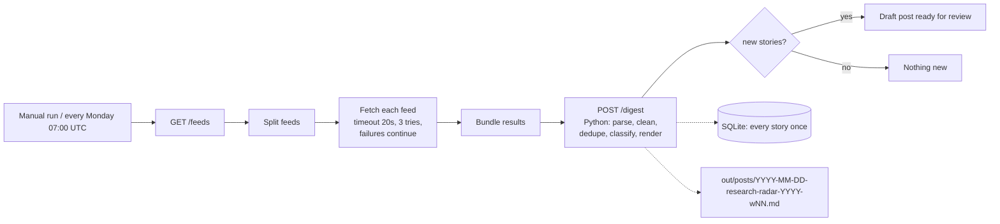

# Research Radar

[](https://github.com/dragon28/research-radar/actions/workflows/ci.yml)

Every week, an **n8n** workflow collects new science and technology stories from public news feeds, removes duplicates, sorts them into the topic pages of [dragon28.github.io](https://dragon28.github.io) (nano, bio, chemical, computer), and writes a draft blog post. A person reviews the draft before anything is published.

n8n does the orchestration (schedule, fetching each feed with retries, branching). A small tested Python package does the processing (parsing, cleaning, deduplication, topic rules, rendering).



## Try it (no n8n, no internet)

```bash
make setup
make demo     # saved sample feeds -> out/demo/2026-11-01-research-radar-2026-w44.md
```

The demo uses five saved feeds, including one broken and one offline. It runs twice, and the second run must add nothing. Result: 5 new stories, 2 duplicates caught (same URL; same headline on another site), 1 story too old, 1 unsafe `javascript:` link dropped, and 2 failed feeds reported without stopping the run.

## Run with n8n

Needs Node.js 24 or newer. n8n is installed inside this folder, not system-wide.

```bash
make n8n-setup    # project-local n8n 2.45.7 + sqlite driver
make serve        # terminal 1: Python API on 127.0.0.1:8765
make n8n-import   # terminal 2: load n8n/workflow.json
make n8n-run      # run the workflow once from the command line
make n8n-editor   # optional: editor at http://127.0.0.1:5678 (localhost only)
```

The first real run (2026-11-01) fetched 7 live feeds with 0 failures and produced 112 stories for week 44: 17 nano, 48 bio, 34 chemical and 13 computer.

## Publishing

Drafts are written to `out/posts/`. To publish one, copy it into the site repo under `_posts/research-radar/` on a new branch and open a pull request. Merging the pull request is the approval step. Nothing is pushed to the live site automatically.

## How it handles problems

- **Duplicates:** a story is skipped if its cleaned URL (tracking parameters removed), feed ID or headline was already seen, across feeds and across runs.
- **Reruns:** each story belongs to one ISO week, so running again in the same week updates the same draft file instead of creating a second one.
- **Failed feeds:** timeouts, HTTP errors and broken XML are listed in the run report under `failed_feeds`. The other feeds still go through.
- **Untrusted text:** HTML and scripts are stripped, only `http(s)` links are kept, XML entity tricks are rejected, and Markdown, HTML and Liquid characters are escaped, so feed text cannot change the page.
- **Old items:** stories older than 14 days are skipped, because feeds keep weeks of history.
- **Copyright:** posts only contain the headline, a link to the original, the source and a short excerpt (at most 220 characters) labelled as coming from the publisher's feed.

## Tests

`make lint test` runs 22 tests: feed parsing (RSS 2.0, RSS 1.0, Atom, broken XML), URL cleaning, topic rules, duplicates, reruns, escaping, the HTTP API, and checks that the exported workflow contains no credentials. CI also runs the real n8n workflow against the saved feeds served from localhost.

## Limitations

- The schedule only fires while this computer and n8n are running. n8n is not hosted anywhere.
- Topic labels come from keyword rules and can be wrong. For example, a cell-imaging story can count as bio even when it is mostly about nanoparticles.
- No summaries are written; the excerpts are the publishers' own feed text.
- A news story is not a peer-reviewed result, and the digest does not judge scientific quality.
- Feeds are chosen by hand in `config/feeds.toml`. Publishers can change or remove them.

## Licences

The code in this repo is MIT. n8n itself is "fair-code" under the Sustainable Use License, not open source; it is installed from npm and not included here.
